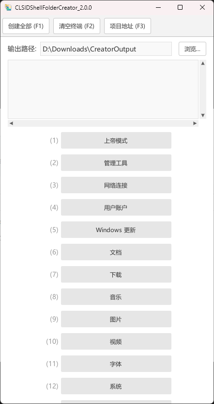
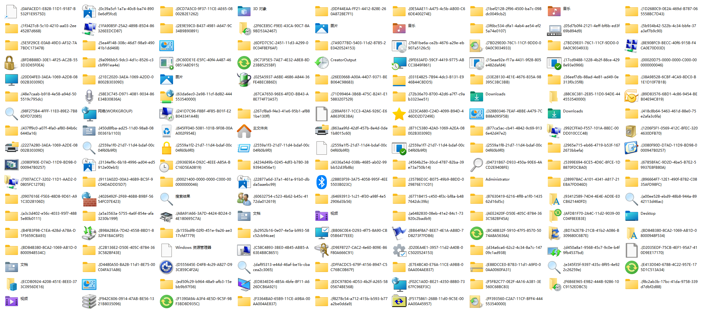

<div align="center">

<h1>CLSID Shell Folder Creator</h1>


[](https://github.com/emilk/egui)
[](LICENSE)

> `Rust` + `eGUI` 编写的小工具，一键创建Windows特殊文件夹（例如“上帝模式”等）

</div>

## ✨ 功能特点

* **滚动列表**：160 个 CLSID 条目，序号 + 名称，点击即创建
* **悬浮提示**：光标悬停显示完整 CLSID，右键直接复制到剪贴板

## 📷 工具截图



## 📂 创建概览



## ⬇️ 下载发行版

[](https://github.com/NeetheCheeBao/CLSIDShellFolderCreator/releases)

## 🛠️ 本地编译

1. 克隆仓库到本地

```bash
git clone https://github.com/NeetheCheeBao/CLSIDShellFolderCreator.git
```

或者

```bash
gh repo clone NeetheCheeBao/CLSIDShellFolderCreator
```

2. 一键编译

```bat
.\build.bat
```

- 产物位置：`dist\CLSIDShellFolderCreator.exe`

## 🗂️ 项目结构

```text
CLSIDShellFolderCreator
|   .gitignore
|   build.bat             # 一键编译脚本
|   build.rs              # 构建脚本，生成图标资源
|   Cargo.lock            # 依赖版本锁定
|   Cargo.toml            # 依赖与 release 优化
|   clsids.json           # CLSID 数据列表
|   LICENSE
|   README.md
|   version.ini           # 版本号
|
+---assets
|       icon.ico          # 图标
|
+---screenshot
|       demo1.png         # 截图
|       demo2.png         # 截图
|
\---src
        app.rs            # 界面与业务逻辑
        data.rs           # 解析 version.ini 与 clsids.json
        main.rs           # 程序入口、窗口与图标
        tip.rs            # Win32 悬停气泡
```

## ⚖️ 许可证

本项目采用 GNU General Public License v3.0 许可证 - 详情请参阅 [LICENSE](LICENSE) 文件。
